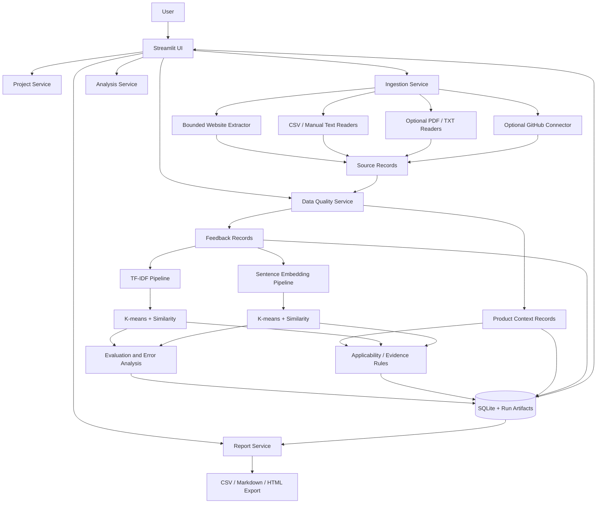
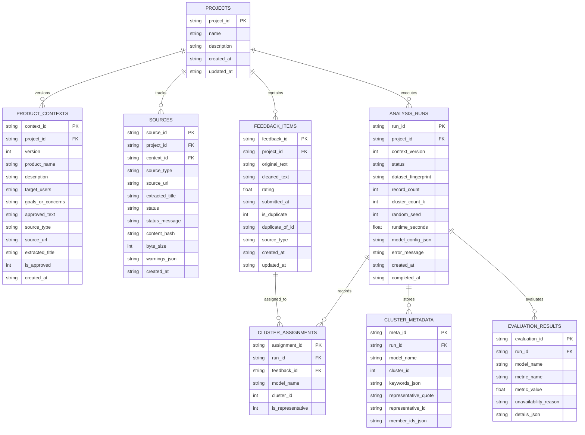

# Architecture
## AI Product Intelligence & Feedback Analyzer

## 1. Architecture Decisions
- **Language/UI:** Python 3.11 recommended; Streamlit UI.
- **Core data:** pandas.
- **Baseline NLP:** scikit-learn TF-IDF.
- **Similarity:** cosine similarity.
- **Clustering:** scikit-learn K-means.
- **Semantic representation:** Sentence Transformers `sentence-transformers/all-MiniLM-L6-v2` (pretrained model, not trained from scratch).
- **Persistence:** SQLite for project/source/feedback/run metadata; local filesystem for optional exports and cached model artifacts.
- **Evaluation:** scikit-learn metrics plus manually labelled examples and documented human inspection.
- **Testing:** pytest.
- **Optional ingestion:** Trafilatura for public webpage text; GitHub API connector only after core workflow works.
- **No required paid API.** Optional LLM-generated descriptions must be an enhancement and must not control core analysis.

## 2. High-Level Component Diagram



## 3. Data Flow
1. User creates a project and enters product context.
2. Source adapters fetch or read permitted content with timeouts, size limits, and validation.
3. Extracted content is previewed and stored with provenance and extraction status.
4. Product-context content and user-feedback content are stored separately.
5. Feedback is validated; original text is preserved. Cleaned text is generated separately.
6. The same feedback subset is passed to both methods.
7. Each method records its configuration, runtime, cluster assignments, similarity results, and metrics.
8. Evaluation combines quantitative metrics with labelled examples and manual review.
9. Findings reference original feedback IDs and source records.
10. The user exports the results and report.

## 4. Logical Data Model & SQLite Architecture (Phase 4)

Persistence is implemented using Python's native `sqlite3` module in `src/database.py`. It requires zero external database servers, runs purely on the local filesystem (`data/product_intelligence.db` by default, configurable via `DATABASE_PATH`), enforces foreign-key referential integrity (`PRAGMA foreign_keys = ON;`), operates in Write-Ahead Logging mode (`PRAGMA journal_mode = WAL;`), and tracks schema migrations via `PRAGMA user_version = 1`.

### 4.1 Entity-Relationship Diagram (ERD)



### 4.2 Table Contracts & Relationships
1. **`projects`**:
   - `project_id` (PK): Stable unique project identifier (`proj-xxxxxxxx`).
   - `name`: Required human-readable name.
   - `description`: Optional project description.
   - `created_at` / `updated_at`: ISO 8601 UTC timestamps.
2. **`product_contexts`**:
   - `context_id` (PK): `pctx-xxxxxxxx`.
   - `project_id` (FK): Cascades on project delete.
   - `version`: Monotonically increasing version counter scoped to each project (`UNIQUE(project_id, version)`).
   - Preserves complete domain history across context edits; analysis runs reference specific context versions.
3. **`sources`**:
   - `source_id` (PK): `src-xxxxxxxx`.
   - `project_id` (FK), optional `context_id` (FK).
   - Captures extraction status, content hashes, and safe warning metadata without saving credentials or sensitive headers.
4. **`feedback_items`**:
   - `feedback_id` (PK), `project_id` (FK) (`PRIMARY KEY (project_id, feedback_id)`).
   - `original_text`: Exact verbatim customer feedback (never mutated).
   - `cleaned_text`: Preprocessed text used for NLP feature extraction.
   - `is_duplicate`: Flag for identical or near-duplicate comments.
   - `duplicate_of_id`: Foreign key pointer to original instance.
   - Conflict handling strategies during import: `error`, `replace_all` (with confirmation), `skip`, and `reassign_id`.
5. **`analysis_runs`**:
   - `run_id` (PK): Stable run identifier (`run-xxxxxxxx`).
   - `context_version`: Context snapshot version active during the run.
   - `status`: Atomic lifecycle state (`running` -> `completed` or `failed`).
   - `dataset_fingerprint`: SHA-256 hash of concatenated evaluated feedback IDs and texts.
   - `record_count`, `cluster_count_k`, `random_seed`, `runtime_seconds`, and versioned `model_config_json`.
6. **`cluster_assignments`**:
   - `assignment_id` (PK): `asgn-xxxxxx-xxxxxx`.
   - `run_id` (FK): Cascades on run deletion.
   - Scoped strictly to `(run_id, model_name, feedback_id)`. New runs never overwrite previous runs.
7. **`cluster_metadata`**:
   - `meta_id` (PK), `run_id` (FK).
   - Stores derived cluster keywords, centroid representative feedback quote/ID, and member feedback IDs.
8. **`evaluation_results`**:
   - `evaluation_id` (PK), `run_id` (FK).
   - Numeric metric values stored in real numeric columns (`metric_value REAL`). Unavailable metrics store explicit unavailability reasons rather than fabricated zero values.
   - Preserves ground-truth benchmark isolation; labels are never saved as clustering features.

### 4.3 Transaction & Privacy Safeguards
- Context-managed atomic transactions (`with db.transaction() as conn:`) with automatic rollback on error.
- All user-provided values executed exclusively via parameterized SQL statements (`?` placeholders).
- Strict project data isolation: queries enforce `WHERE project_id = ?` to prevent cross-project record leakage.
- Offline run reconstruction: historical runs load assignments and evaluations without re-invoking Sentence Transformers or TF-IDF models.
- Single-user local storage disclaimer: SQLite provides file-level integrity, not encryption at rest or multi-user cloud synchronization.

## 5. Core Python Interfaces
Implement stable, typed interfaces. Keep responsibilities cleanly separated.

```python
# Context Ingestion & SSRF-Safe Web Extraction (src/context_ingestion.py)
def is_ip_allowed(ip_str: str) -> bool: ...
def validate_url_safety(url_str: str) -> tuple[bool, str, str]: ...
def extract_webpage_content(url: str, timeout: int = 10, max_size_bytes: int = 2 * 1024 * 1024) -> ExtractionResult: ...

# Data Validation & Parsing (src/data_processing.py)
def load_feedback_csv(file_bytes: bytes, text_column: str | None = None, id_column: str | None = None) -> ValidationReport: ...
def load_feedback_from_raw_text(text: str) -> ValidationReport: ...
def normalize_whitespace(text: str) -> str: ...

# AI Clustering (src/clustering.py)
def run_tfidf_clustering(records: list[FeedbackRecord], n_clusters: int, random_state: int = 42) -> ModelResult: ...
def run_embedding_clustering(records: list[FeedbackRecord], n_clusters: int, random_state: int = 42, embedding_cache: dict | None = None) -> ModelResult: ...

# Evaluation & Metrics (src/evaluation.py)
def compare_models(model_a: ModelResult, model_b: ModelResult, reference_labels_df=None) -> tuple[EvaluationReport, EvaluationReport]: ...

# Evidence-Grounded Insights (src/insights.py)
def generate_cluster_insights(model_result: ModelResult, product_context: ProductContext | None = None) -> InsightsReport: ...

# Multi-Format Exports (src/export.py)
def export_feedback_records_csv(records: list[FeedbackRecord], model_results: list[ModelResult]) -> str: ...
def export_cluster_summaries_csv(insights_report: InsightsReport) -> str: ...
def export_model_evaluation_csv(eval_reports: list[EvaluationReport]) -> str: ...
def export_full_markdown_report(insights_report: InsightsReport, eval_reports: list[EvaluationReport], product_context: ProductContext | None = None) -> str: ...
```

Use dataclasses for typed domain representations. Keep Streamlit calls out of AI, ingestion, and reporting modules.

## 6. Result Contracts
### `ProductContext`
- `product_name`: Title of the product
- `description`: Manual description text
- `target_users` and `goals`: Key domain targets
- `source_type`: `manual`, `pasted_docs`, or `webpage_url`
- `source_url`: URL if fetched
- `extracted_title` and `raw_extracted_text`: Extracted content before cleaning
- `approved`: Boolean flag requiring explicit user review
- `warnings`: List of extraction or quality notes

### `ExtractionResult`
- `source_url`: Original URL
- `status`: `success`, `blocked_ssrf`, `timeout`, `unsupported_content_type`, or `error`
- `extracted_title`: Parsed webpage title
- `extracted_text`: Cleaned readable text body
- `retrieved_at`: ISO timestamp
- `status_message`: Safe, explanatory user message
- `byte_size`: Size of response payload
- `warnings`: Warning strings

### `ClusterInsight`
- `cluster_id` & `cluster_name`: Neutral theme label (`Cluster 1`, `Cluster 2`)
- `record_count`: Number of member feedback items
- `percentage_share`: Percentage of valid feedback in cluster
- `keywords`: Distinctive extracted TF-IDF/frequency terms
- `representative_quote`: Centroid-closest real feedback text
- `representative_id`: Stable record ID of representative quote
- `member_ids`: List of all member feedback IDs
- `exact_duplicate_count`: Number of redundant feedback instances
- `context_relevance`: Cautious, evidence-derived relationship to approved product context
- `derivation_explanation`: Traceable mathematical and clustering origin

### `InsightsReport`
- `model_name`: Evaluated model
- `cluster_insights`: List of `ClusterInsight` objects
- `prioritized_insights`: Insights sorted transparently by member volume and uniqueness
- `total_valid_records`: Denominator count
- `data_quality_warnings`: Session data warnings

## 7. Evaluation Rules
- Compare methods on the same feedback records.
- Record preprocessing, model ID/version, number of clusters, random seed, runtime, and dependency versions.
- Do not report silhouette score when its mathematical preconditions are not met (for example, fewer than two distinct clusters or one cluster per sample).
- Silhouette score is not enough; manually inspect cluster coherence.
- If similarity precision/recall is reported, use a manually labelled pair set and document its construction.
- Never fabricate results. Store the actual computed values.
- Use a fixed, documented sample dataset for repeatable demos.

## 8. Source Ingestion and Safety
- Only fetch public, permitted URLs. Do not bypass login or access controls.
- Set connection/read timeouts, response-size limits, and content-type checks.
- Reject localhost, private, link-local, and other internal IP destinations; validate DNS results and re-check every redirect to reduce SSRF risk.
- Restrict schemes to HTTP/HTTPS.
- Do not execute downloaded content.
- Do not trust file extensions alone; validate file content and size.
- Show source failures and partial extraction clearly.
- Preserve provenance from every feedback item to its source.

## 9. Failure Modes
- URL blocked, invalid, or requires JavaScript: show failure/partial status and allow manual context.
- No feedback available: explain that product context alone is insufficient for feedback clustering.
- Too few records or clusters: stop or warn rather than return misleading metrics.
- Embedding model unavailable: show installation/model-loading error; TF-IDF baseline remains runnable.
- Invalid CSV columns: allow column selection and explain the issue.
- Optional API unavailable: core analysis remains functional.

## 10. Phase 5: Decision Support & Explainability Architecture

### 10.1 Applicability Assessment (`src/applicability.py`)
- Evaluates discovered clusters against approved product context using pure deterministic rules.
- **Three Strict Primary Statuses:**
  - `Likely relevant`: available evidence exhibits direct lexical/conceptual overlap with explicitly documented product goals or description without severe internal contradiction.
  - `Needs validation`: partial or ambiguous overlap, zero direct overlap (potential emerging or out-of-scope issue), or detected contradictory sentiment within member feedback.
  - `Insufficient information`: missing or unapproved product context, empty cluster, or feedback lacking minimum informative tokens (stopwords only).
- **traceability Contract (`ApplicabilityAssessment`):**
  - `status`, `explanation`, `relevant_context_concepts`, `supporting_feedback_ids`, `supporting_quotes`, `contradictory_evidence`, `signals_used`, `missing_information`, `next_validation_step`, `assessment_method`, `context_version`, `run_id`.

### 10.2 Investigation Recommendations (`src/recommendations.py`)
- Guides human exploration by recommending **what to investigate**, never pretending to make autonomous product decisions.
- **Evidence Integrity & Duplicate Accounting:**
  - Duplicate feedback submissions are explicitly tracked as repeated submissions, not independent corroborations by multiple customers.
  - Verbatim evidence quotes are directly mapped to verified `feedback_id` records.
- **Frequency-Based Investigation Queue:**
  - Deduplicates equivalent recommendations across clusters.
  - Orders prompts strictly by unique feedback volume descending, explicitly disclaiming defect severity or commercial urgency.

### 10.3 Explainability Layer (`src/explanations.py`)
- Educational breakdown for beginners explaining the mechanics of:
  - TF-IDF vectorization, L2 normalization, and cosine distance K-Means.
  - MiniLM (`all-MiniLM-L6-v2`) dense 384-dimensional continuous coordinate embeddings and nuance limitations (jargon, sarcasm).
  - Metric interpretations (Silhouette, Davies-Bouldin, ARI, NMI, Entropy).
- **Cross-Representation Metric Incomparability Caveat:**
  - Enforces that internal metrics in sparse high-dimensional space and dense continuous neural space cannot be directly compared numerically.
  - Establishes the Four Pillars of Evaluation: Internal Cluster Geometry, Reference Label Alignment, Evidence Quality, and Practical Product Utility.
